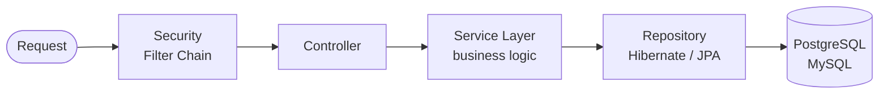

  
  
  

I build backend systems where performance and security come first. My day-to-day is Java and Spring Boot, and I care most about turning complex business logic into code that a team can read, test, and maintain.

  

 

<table>
  <tr>
    <td width="33%" valign="top">
      <b>Currently</b> 
      Hardening applications with Spring Security and improving communication between microservices.
    </td>
    <td width="33%" valign="top">
      <b>Goal</b> 
      Turning complex business logic into clean, maintainable, and scalable Java code.
    </td>
    <td width="33%" valign="top">
      <b>Philosophy</b> 
      <i>"Code is like humor. When you have to explain it, it's bad."</i>
    </td>
  </tr>
</table>

---

## What I Do

- Design and build RESTful APIs and backend services with **Spring Boot**
- Implement authentication and authorization with **Spring Security**
- Model and optimize data access with **Hibernate/JPA**, **PostgreSQL**, and **MySQL**
- Structure and connect **microservices** with performance and security in mind
- Containerize and ship applications with **Docker** on **Linux**

## How I Think About a Request

Every service I write follows the same layered path, so security is part of the structure instead of an afterthought.

## Tech Stack

| | |
|---|---|
| **Backend** |     |
| **Databases** |   |
| **DevOps** |    |
| **API Testing** |   |

<!--
## Featured Projects

Uncomment this block and replace REPO_NAME with your best 2-4 repositories.
Pinned cards update automatically from your repo description.

  
  

-->

## GitHub Activity

  <picture>
    <source media="(prefers-color-scheme: dark)" srcset="https://github-readme-stats.vercel.app/api?username=mobinnoori&show_icons=true&count_private=true&hide_border=true&bg_color=0F1420&title_color=F5A524&text_color=D5DFEC&icon_color=6DB33F">
    
  </picture>
  

## Get in Touch

I'm open to conversations about backend engineering, application security, and new opportunities. The fastest way to reach me is [email](mailto:mobin.noori21@gmail.com) or [LinkedIn](https://www.linkedin.com/in/mobin-noori-93194b263/).

 

